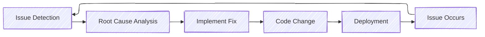
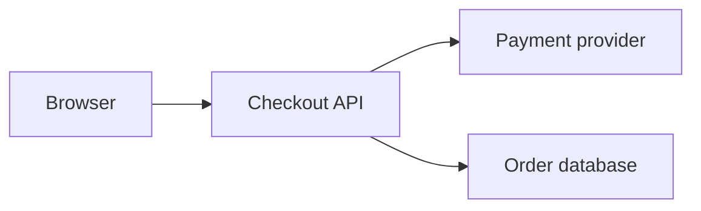
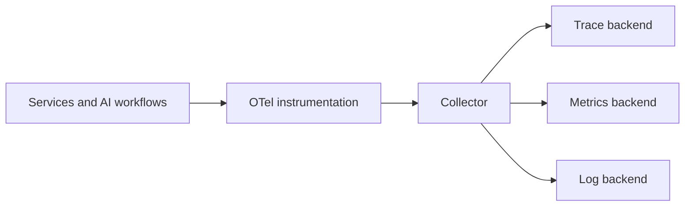
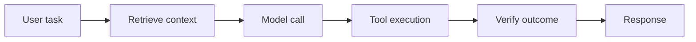

# Observability, Monitoring and Alerting
A practical guide to work for the weekend instead of on the weekend.

<div class="mt-6 text-sm opacity-70">2026 refresh · Reliability for services and AI workflows</div>

---
layout: about-me
helloMsg: Hello!
name: Zach Russell
imageSrc: https://github.com/zachatrocity/o11y-slides/blob/3d3f7e786674d16ff131e8aab9899d8e83a2163d/images/PXL_20231029_010441145.MP.jpg?raw=true
position: left
job: Lead Software Engineer
line1: Disney Streaming - Web Commerce
line2: Sign up, conversion, account management
social1: "email: zach@zachs.io"
social2: "@zach:matrix.zachs.io"
---

---

# Three Questions, One Reliability Loop

<div class="grid grid-cols-3 gap-5 text-sm">
<div>

## Monitoring
**Is something wrong?**

Track known signals: latency, errors, traffic, and saturation.

</div>
<div>

## Observability
**Why is it happening?**

Explore correlated metrics, logs, and traces—even for failures you didn't predict.

</div>
<div>

## Alerting
**Who needs to act?**

Notify an owner when user impact requires a concrete response.

</div>
</div>

<div class="bg-blue-100 color-black p-4 rounded mt-8">
Checkout is slow, but CPU looks normal. What tells you there is a problem—and what helps you explain it?
</div>

<!--
Merge the original three definitions and monitoring-vs-observability distinction.
These are complementary capabilities, not mutually exclusive tool categories.
Take one audience answer, then move on; save the full diagnosis for the exercise.
-->


---

# The Real Cost of Downtime

<div grid="~ cols-2 gap-8">
<div>

## Start with your user journey
- Failed signups and abandoned checkouts
- Delayed work, support load, lost trust
- Recovery effort and contractual impact

## Estimate, don't borrow a headline
At-risk revenue ≈ affected attempts × baseline conversion × value per conversion

</div>
<div class="bg-blue-100 color-black p-4 rounded text-sm">

**Historical example · October 20, 2025**

AWS traced the US-EAST-1 DynamoDB disruption to a race condition in DNS management. Recovery also involved downstream EC2 and Network Load Balancer problems.

**Discussion:** Can your synthetic checkout detect a dependency failure when your own hosts look healthy?

[Source: AWS incident report](https://aws.amazon.com/message/101925/)

</div>
</div>

<!--
The formula is an illustrative planning estimate, not realized loss: some users retry,
some transactions are deferred, and conversion varies by cohort. Avoid universal
cost-per-minute figures. This AWS example was already present in the 2025 deck;
it is retained as historical context, not presented as a new 2026 incident.
-->

---

# The Developer Feedback Loop

<div class="mb-5">
Proper observability, monitoring and alerting significantly shortens the path from:
</div>



<div v-click class="bg-green-100 color-black p-3 rounded mt-4">
<b>Pop Quiz:</b> In which parts of this loop do our three topics (observability, monitoring, alerting) play critical roles?
</div>

<!--
Monitoring: Helps during "Issue Occurs" to "Issue Detection" by continuously checking system health

Alerting: Critical in "Issue Detection" phase by notifying the right people at the right time

Observability: Essential during "Root Cause Analysis" to understand why the issue happened

All three help shorten the entire loop by identifying issues faster and providing context for fixes
-->

---

# Useful Signals, Useful Logs

<div grid="~ cols-2 gap-6">
<div class="text-sm">

## Four golden signals
- **Latency:** how long requests take
- **Traffic:** how much demand arrives
- **Errors:** which requests fail
- **Saturation:** where work queues up

## Logs that explain a failure
Use structured events, trace correlation, and release context. Avoid unnecessary personal data.

</div>
<div>

```json
{
  "level": "ERROR",
  "service": "checkout",
  "trace_id": "4bf92f3577b34da6a3ce929d0e0e4736",
  "release_cohort": "canary",
  "message": "Payment provider timed out",
  "latency_ms": 2500
}
```

<div class="text-sm mt-4">Which release cohort should we compare with this one?</div>

</div>
</div>

<!--
One enriched example replaces the before/after log pair. Keep timestamps, span IDs,
and service versions in real telemetry; shortened here for readability.
Golden signals: https://sre.google/sre-book/monitoring-distributed-systems/
-->


---

# Tracing: Follow the Slow Request



- **Trace:** the request journey; **span:** one timed operation.
- Propagate context across service boundaries and asynchronous work.
- Compare slow/error traces with healthy ones and with the previous release.
- Sample deliberately; a missing trace is not proof that nothing failed.

<div class="bg-purple-100 color-black p-3 rounded mt-6 text-sm">
Checkout takes 3 seconds. The payment span takes 2.5 seconds. Investigate that dependency before adding more web servers.
</div>

<!--
Conceptual illustrative timings, not a measured incident. Spans can overlap;
find the critical path rather than blindly summing span durations.
This replaces the separate tracing definition and remote flamegraph-image slides.
-->


---

# A Small Toolkit, Not a Shopping List

| Job | Examples |
| --- | --- |
| Instrument and transport | OpenTelemetry |
| Explore metrics, logs, and traces | Datadog or Grafana-based stack |
| Route alerts to an owner | PagerDuty or Grafana IRM |
| Query Datadog from a terminal or agent | **pup** |

<div class="bg-blue-100 color-black p-3 rounded mt-6 text-sm">
Choose a connected workflow: user symptom → evidence → owner → action. More tools do not automatically mean more visibility.
</div>

<div class="text-xs mt-5">
<a href="https://docs.datadoghq.com/cli/">Datadog pup CLI</a> · <a href="https://opentelemetry.io/docs/">OTel</a> · <a href="https://grafana.com/products/cloud/irm/">Grafana IRM</a>
</div>

<!--
Spend at most 30 seconds here. Examples are not an exhaustive inventory or a
ranking. Grafana-based stack includes its telemetry backends, not just dashboards.
Pup is a Datadog interface, not a separate telemetry store or an AI model.
-->


---

# OpenTelemetry: Instrument Once

<div grid="~ cols-2 gap-8">
<div>



</div>
<div class="text-sm">

- **OpenTelemetry is instrumentation and transport**, not a storage/query UI.
- Correlate logs and spans; carry context across HTTP, queues, and tool calls.
- Attach service version and release cohort to make regressions explainable.
- Control cardinality, sampling, retention, and sensitive data before export.

</div>
</div>

<div class="text-xs mt-4">
<a href="https://opentelemetry.io/docs/">OpenTelemetry documentation</a> · GenAI conventions are evolving: check the status of the specific conventions you adopt.
</div>

---

# pup: Two Queries, One Investigation

Datadog's CLI gives humans and agents the same query interface.

<div grid="~ cols-2 gap-6">
<div>

### 1. Find checkout errors

```bash
pup --read-only logs search \
  --query="service:checkout status:error" \
  --from="30m" --to="now"
```

<div class="text-sm mt-4">Look for repeated failures and trace IDs.</div>

</div>
<div>

### 2. Check infrastructure context

```bash
pup --read-only metrics query \
  --query="avg:system.cpu.user{env:prod}" \
  --from="30m" --to="now"
```

<div class="text-sm mt-4">Test the CPU hypothesis—not task success.</div>

</div>
</div>

<div class="text-xs mt-6">
Prerequisite: install pup and authenticate with <code>pup auth login</code>. Adapt service/env filters to your telemetry. Examples are documentation-checked, not live account results.
</div>

<div class="text-xs mt-3">
<a href="https://github.com/DataDog/pup/blob/6c3a4707f5ab87688566020d868a50810db08166/docs/EXAMPLES.md">pup examples (pinned source)</a> · Use scoped read access; CLI read-only mode is an extra guard, not a permissions boundary.
</div>

<!--
Budget 90 seconds. No live login or incident required during the talk. Run auth
before presenting; use the appropriate Datadog site and permissions. The sample
checkout service and env:prod tag must exist; zero results can mean missing tags,
no matching traffic, missing ingestion, or restricted access—not system health.
Pup returns structured output suitable for scripts/agents; inspect pagination and
truncation before making completeness claims. No fabricated output shown.
-->


---

# HTTP 200 Is Not a Successful AI Task

<div grid="~ cols-2 gap-8">
<div>

## Keep the golden signals
- Request and end-to-end latency
- Time to first token for streaming UX
- Errors, timeouts, retries, rate limits
- Token usage and estimated cost per task

</div>
<div>

## Add outcome signals
- Did the task actually complete?
- Was the answer supported by evidence?
- Did the tool perform the intended action?
- Did the user correct or abandon it?

</div>
</div>

<div class="bg-blue-100 color-black p-3 rounded mt-5 text-sm">
A fast, inexpensive answer can still be wrong. Track quality, latency, and cost together; segment by model, prompt version, and release cohort.
</div>

<div class="text-xs mt-4">
<a href="https://opentelemetry.io/blog/2026/genai-observability/">OTel: Inside the LLM Call (May 2026)</a> · <a href="https://www.anthropic.com/research/demystifying-evals-for-ai-agents">Anthropic: Agent evals (January 2026)</a>
</div>

<!--
Outcome measures depend on the task; these are suggested signals, not a universal
standard. Model-graded quality is an estimate: calibrate against human-reviewed
examples and deterministic outcome checks. Token-derived cost needs provider
pricing and cache accounting; it is not an invoice.
-->

---

# Trace the Workflow, Not Just the Model Call



- One trace connects retrieval, inference, tool calls, retries, and verification.
- Record model identity, prompt/config version, durations, and usage.
- Link sampled eval outcomes back to traces; compare release cohorts.
- Don't capture prompts, responses, or tool payloads by default: they may contain secrets or personal data.

<div class="text-xs mt-5">
<a href="https://opentelemetry.io/docs/specs/semconv/gen-ai/">OpenTelemetry GenAI semantic conventions</a> · Check per-convention maturity and pin versions; do not assume every SDK emits the same fields.
</div>

<!--
This is a conceptual workflow, not a claim that all agents follow a linear graph.
Use child spans or links as appropriate for asynchronous or multi-agent work.
Prompt/config version and outcome fields may be application-specific attributes.
Keep high-cardinality task identifiers in traces, not metric labels. If content
capture is needed, use explicit access controls, redaction, sampling, and retention.
-->

---

# AI for On-Call: A Copilot with Evidence

<div grid="~ cols-2 gap-8">
<div>

## Useful assistance
- Summarize an incident timeline
- Draft queries and find relevant runbooks
- Compare deployments and trace cohorts
- Propose hypotheses with source links

</div>
<div>

## Earn the right to automate
- Start with read-only access
- Test against known, injected failures
- Measure diagnosis and recovery outcomes
- Bound actions; require approval for risky changes

</div>
</div>

<div class="bg-yellow-100 color-black p-3 rounded mt-5 text-sm">
A plausible root-cause story is not proof. Require telemetry evidence, an audit trail, and a rollback path.
</div>

<div class="text-xs mt-4">
Research reference: <a href="https://www.microsoft.com/en-us/research/blog/aiopslab-building-ai-agents-for-autonomous-clouds/">Microsoft Research: AIOpsLab (December 2024)</a> — a fault-injection/evaluation framework, not proof of production autonomy. Guardrails above are recommendations for this talk.
</div>

---

# Monitor the Journey, Budget the Telemetry

<div grid="~ cols-2 gap-8" class="text-sm">
<div>

## Cover the user experience
- Synthetic checkout: does the journey work?
- Application signals: errors and latency
- Business outcome: completed checkouts
- Infrastructure: saturation and capacity

</div>
<div>

## Keep the signal useful
- Segment by service, region, and release
- Budget cardinality, retention, and sampling
- Keep user/task IDs out of metric labels
- Test alerts and telemetry freshness

</div>
</div>

<div class="bg-yellow-100 color-black p-3 rounded mt-6 text-sm">
A green host dashboard does not prove users can check out. An empty error chart may mean the telemetry pipeline is broken.
</div>

<!--
Consolidates monitoring types, best practices, and pitfalls. Push/pull terminology,
USE-method detail, and dashboard audience taxonomy are reference material rather
than separate speaking beats. Lead with outcomes, use resource signals to diagnose.
-->


---

# Page on User Impact: An SLO Example

- **SLI:** successful eligible checkout attempts / all eligible checkout attempts
- **SLO:** 99.9% over 30 days → **0.1% error budget**
- **Burn rate:** observed bad-event fraction / allowed bad-event fraction
- At **1% failures**, burn rate = 0.01 / 0.001 = **10×**

<div class="bg-blue-100 color-black p-4 rounded mt-5 text-sm">
Example fast-burn page: burn rate above <b>14.4× in both 1h and 5m windows</b>.<br>
The longer window establishes impact; the shorter confirms it is still happening.
</div>

Define eligibility, low-traffic behavior, missing-data alerts, ownership, and a runbook before paging.

<div class="text-xs mt-4">
Foundational reference (not new in 2026): <a href="https://sre.google/workbook/alerting-on-slos/">Google SRE Workbook: Alerting on SLOs</a>. This is one fast-burn rule, not a complete paging policy.
</div>

<!--
For a 30-day window, a sustained 14.4x burn over one hour spends about 2% of the
budget under steady traffic. Pair with slower-burn rules and ticket routing.
Define eligibility explicitly (e.g. distinguish expected payment declines from
service failures). Low-volume journeys need synthetics and careful denominators.
-->

---

# Every Alert Needs an Owner and an Action

| Route | When | Include |
| --- | --- | --- |
| **Page now** | Active user harm / fast budget burn | Owner, impact, runbook, evidence |
| **Ticket** | Slow burn / capacity work with time to act | Due date, trend, next step |
| **Dashboard / event** | Context without urgent action | Release or recovery annotation |

- Group related symptoms; avoid paging three teams for the same failure.
- Review noisy alerts and test the delivery path.

<div class="bg-yellow-100 color-black p-3 rounded mt-6 text-sm">
Would you page for 95% CPU on a development server? What about failed production checkouts with normal CPU?
</div>

<!--
Replaces the original alert definition/activity plus dense severity cards.
Severity names differ by organization. Route by impact and urgency, not a universal
P0/P1/P2 mapping. Keep the audience discussion to one brief response.
-->


---

# Case Study: AI Quality Regressions

<div grid="~ cols-2 gap-8">
<div>

## What Anthropic reported
- Reasoning-effort defaults changed
- A caching bug repeatedly cleared prior reasoning
- A prompt change hurt coding quality
- The API and inference layer were unaffected

</div>
<div>

## What we can learn
- Observe the product, not just the endpoint
- Track configuration and prompt changes
- Test long-lived sessions, not only fresh ones
- Segment results: aggregates hide affected cohorts

</div>
</div>

<div class="text-xs mt-5">
<a href="https://www.anthropic.com/research/april-23-postmortem">Anthropic postmortem · April 23, 2026</a>. Vendor's incident account; lessons on the right are our interpretation, not measured claims of improvement.
</div>

<!--
Anthropic describes three changes affecting Claude Code, the Agent SDK, and Cowork,
resolved by April 20. Use this to distinguish application/harness failures from
model-serving availability. Ask: which of our current dashboards would notice?
-->

---

# Safer Changes: Canary Releases

<div class="bg-yellow-100 color-black p-3 rounded mt-2 mb-8 text-sm">
<b>Discussion:</b> Does anyone know what canary releases are and how observability can help us accomplish them?
</div>

<div v-click grid="~ cols-2 gap-4">

<div>

## The Challenge
- Upgrade from legacy Next.js 
- Upgrade Node.js from:
  - a supported LTS release to the next supported LTS release
- Validate and ensure no negative user impact
</div>

<div>

## Approach
1. Upgrade on a feature branch
2. Run E2E tests in staging; inspect telemetry
3. Start a small, representative canary
4. Compare user SLIs; expand or roll back
5. For AI, compare task quality and cost

</div>
</div>

---

# Hands-On Exercise: Checkout Is Slow

<div class="text-center mb-4">
Hypothetical training scenario (all numbers are illustrative): checkout is slow.
</div>

<div class="grid grid-cols-3 gap-2">
  <div class="border p-1">
    <div class="text-center font-bold">Infrastructure Metrics</div>
    <div class="text-sm">
      ✅ CPU: 30% utilization<br/>
      ✅ Memory: 45% utilization<br/>
      ✅ Network: Normal traffic<br/>
      ✅ Disk: 60% capacity<br/>
    </div>
  </div>
  <div class="border p-1">
    <div class="text-center font-bold">Application Metrics</div>
    <div class="text-sm">
      ❌ Response time: 3.5s (up from 0.8s)<br/>
      ✅ Error rate: 0.1% (normal)<br/>
      ✅ Request rate: Normal<br/>
      ❓ Cache hit rate: 45% (down from 95%)<br/>
    </div>
  </div>
  <div class="border p-1">
    <div class="text-center font-bold">Database Metrics</div>
    <div class="text-sm">
      ❌ Query time: 2.9s (up from 0.3s)<br/>
      ❌ Connection count: 95/100<br/>
      ❓ Index usage: 20% (down from 90%)<br/>
      ✅ Disk usage: Normal<br/>
    </div>
  </div>
</div>

<div class="mt-6 bg-blue-100 color-black p-4 rounded">
<div class="font-bold mb-2">Group Task:</div>
<ol class="text-xs">
  <li>What additional information would you want to look for?</li>
  <li>What do you think is the root cause?</li>
  <li>What immediate actions would you take?</li>
  <li>What alerts should have triggered but didn't?</li>
</ol>
</div>

<!-- 
Database-specific metrics: Query plans, table scans vs. index scans, recent schema changes
Recent deployments: Was there a code or schema change recently?
Cache invalidation events: When and why did the cache hit rate drop?

Likely Causes:
Missing/unused index: The dramatic drop in index usage (90% → 20%) combined with slow queries strongly suggests an index problem
- Recent schema change that invalidated indexes
- New query pattern not covered by existing indexes
- Database statistics out of date
- Index corruption

-->

---

# Key Takeaways

<div class="grid grid-cols-2 gap-x-10 gap-y-6">
  <div>
    <h3 class="border-b pb-2 mb-2">Observability</h3>
    <ul>
      <li>Not just monitoring, but understanding</li>
      <li>Combine metrics, logs, and traces</li>
      <li>Design for unknown-unknowns</li>
      <li>Structured, correlated data is key</li>
    </ul>
  </div>
  <div>
    <h3 class="border-b pb-2 mb-2">Monitoring</h3>
    <ul>
      <li>The Four Golden Signals</li>
      <li>User journeys before host dashboards</li>
      <li>Balance coverage with signal-to-noise</li>
      <li>Test your monitoring together with your code</li>
    </ul>
  </div>
  
  <div>
    <h3 class="border-b pb-2 mb-2">Alerting</h3>
    <ul>
      <li>Actionable, accurate, properly prioritized</li>
      <li>Fight alert fatigue aggressively</li>
      <li>Include context and next steps</li>
      <li>Regular review and refinement</li>
    </ul>
  </div>
  <div>
    <h3 class="border-b pb-2 mb-2">Implementation</h3>
    <ul>
      <li>Start small, iterate often</li>
      <li>Observability is a team culture, not just tools</li>
      <li>Learn from incidents</li>
      <li>For AI: verify outcomes, not just HTTP success</li>
    </ul>
  </div>
</div>

---

# Q&A

<div class="text-center">
  
  <p class="text-xl mt-4">What would you like to know more about?</p>
  <div class="mt-4 text-sm">
    Contact: zach@zachs.io | Slides available at: https://zachatrocity.github.io/o11y-slides/
  </div>
</div>

---

# Resources: Keep Learning

<div grid="~ cols-2 gap-8" class="text-sm">
<div>

## New for this refresh
- [Datadog pup CLI](https://docs.datadoghq.com/cli/)
- [OTel: Inside the LLM Call (May 2026)](https://opentelemetry.io/blog/2026/genai-observability/)
- [Anthropic: Agent evals (January 2026)](https://www.anthropic.com/research/demystifying-evals-for-ai-agents)
- [Anthropic: Quality postmortem (April 2026)](https://www.anthropic.com/research/april-23-postmortem)
- [Microsoft: AIOpsLab (2024 foundations)](https://www.microsoft.com/en-us/research/blog/aiopslab-building-ai-agents-for-autonomous-clouds/)

</div>
<div>

## Foundations and living references
- [OpenTelemetry documentation](https://opentelemetry.io/docs/)
- [GenAI semantic conventions](https://opentelemetry.io/docs/specs/semconv/gen-ai/)
- [Google SRE: Alerting on SLOs](https://sre.google/workbook/alerting-on-slos/)
- [AWS: October 2025 incident report](https://aws.amazon.com/message/101925/)

</div>
</div>

<div class="text-xs mt-6">Reviewed October 25, 2026 · Source notes and presentation recommendations: docs/2026-refresh.md in the repository.</div>
